

  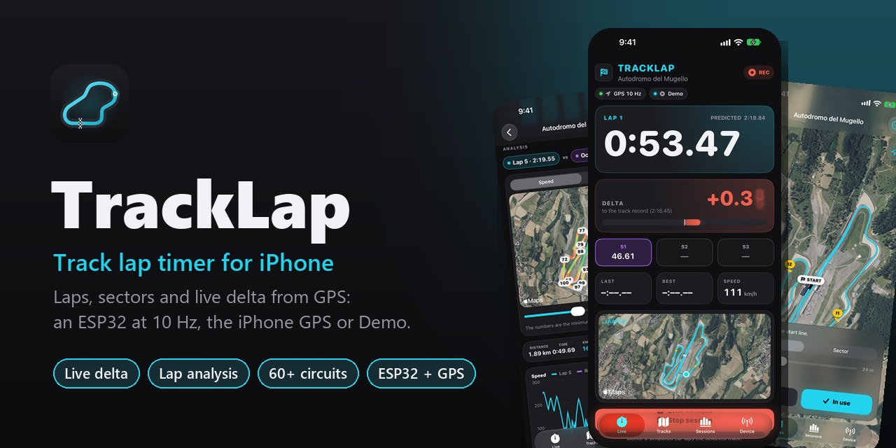

  <a href="README.md">Italiano</a> · <b>English</b>

  
  
  
  

**TrackLap** is a track lap timer for iPhone. Lap times, sectors and a live delta worked out from
GPS: with an ESP32 and a 10 Hz GPS over Bluetooth, with the iPhone's own GPS, or with a simulated car
to try everything right away. The line crossing is interpolated between two fixes, so at 10 Hz the
times are right to a few hundredths.

<table>
  <tr>
    <td width="34%">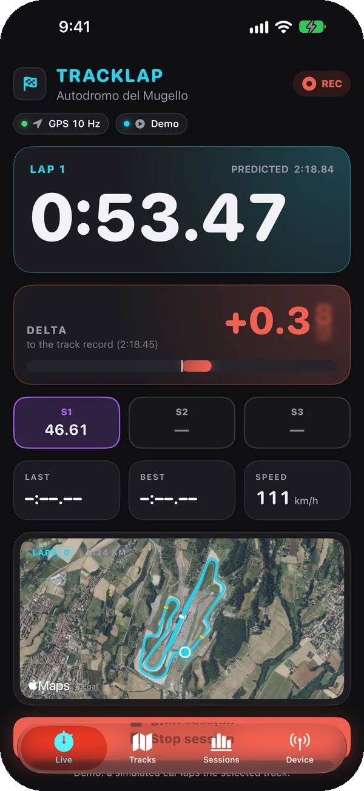</td>
    <td>
      <h3>Live</h3>
      
The running lap time, the <b>delta against the best lap</b> with a green or red bar, the
      predicted time and coloured sectors: purple for the best, green for better than the lap before,
      yellow for slower. Below, the last lap, the best, the speed and the circuit on satellite imagery.

      
At the end of a lap a vibration and a <b>voice call-out</b> of the time and the gap. The delta
      can compare with the track record from earlier sessions, so it works from the first lap. The
      screen stays on, also in landscape for a dashboard mount.

    </td>
  </tr>
  <tr>
    <td>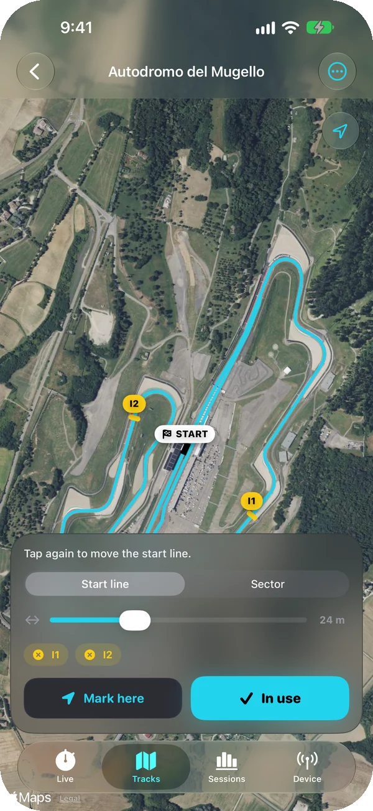</td>
    <td>
      <h3>Tracks</h3>
      
<b>Search as you type</b> worldwide on OpenStreetMap, tracks near you or near a town, a
      catalogue of <b>60+ famous circuits</b> and "create here" on the spot.

      
The layout downloads by itself. In the editor on satellite imagery you tap the track and the
      start line lays itself across it; add up to 4 sector lines, or "mark here" puts the line where
      you stand.

    </td>
  </tr>
  <tr>
    <td>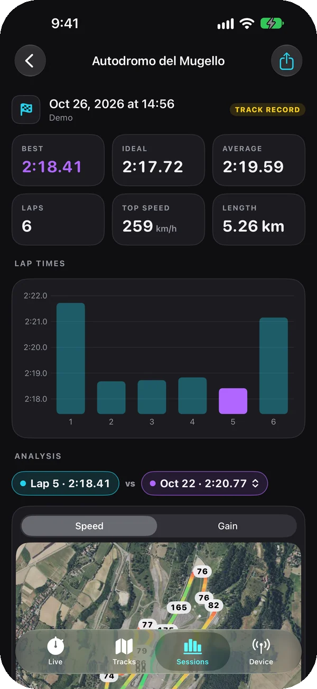</td>
    <td>
      <h3>Sessions</h3>
      
Every lap is saved as soon as it ends. For each session the best, the <b>ideal lap</b> (the
      best sectors added up), the average, the top speed and the lap time chart.

      
Export to <b>GPX and CSV</b>, with the speed and g of every point, for spreadsheets and
      analysis tools.

    </td>
  </tr>
  <tr>
    <td>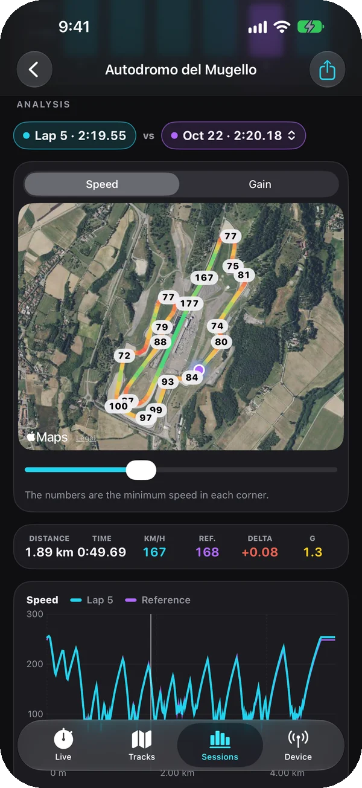</td>
    <td>
      <h3>Analysis</h3>
      
Compare a lap with another lap of the session or with the best lap of an earlier session on
      the same track. One cursor moves both cars on the map and on the speed and delta charts.

      
Map coloured by speed with the <b>minimum speed of every corner</b>, or by where you gain and
      lose; sector comparison and a <b>friction circle</b> with lateral and longitudinal g worked out
      from GPS.

    </td>
  </tr>
</table>

In Italian, English, Spanish, French, German and Portuguese, following the iPhone's language; km/h or mph.

## With friends

- **Challenges**: in a session, tap *Share the best lap* and send a `.tracklap` file with WhatsApp,
  Messages or AirDrop. Whoever opens it with TrackLap gets the track with the same start line,
  chases that lap in Live (the delta is against it, on the ESP32 dashboard too, and the voice reads
  the gap at the end of the lap) and compares it corner by corner in the analysis. No account and
  no server: it works offline and on different days.
- **Live group**: one creates the group and the others join with a five-character code or by
  scanning the QR code. Live shows the group's standings (best, last lap, gap to the leader), your
  friends' dots on the map and the real gap to the cars just ahead and behind, worked out from the
  GPS times of both cars at the same point. At the end of each lap the voice reads your place and
  the ESP32 shows it on its screen. Every phone times its own laps: the network only sends the times
  to the others, so a delay or a gap in coverage doesn't change them.
- **Online leaderboards**: with *Publish my best laps* on, the best lap of every session goes to the
  leaderboard of its track, recognised by the start line; the ESP32 (10 Hz) and the iPhone (1 Hz)
  have separate boards, and Demo laps never go in.

<table>
  <tr>
    <td width="33%">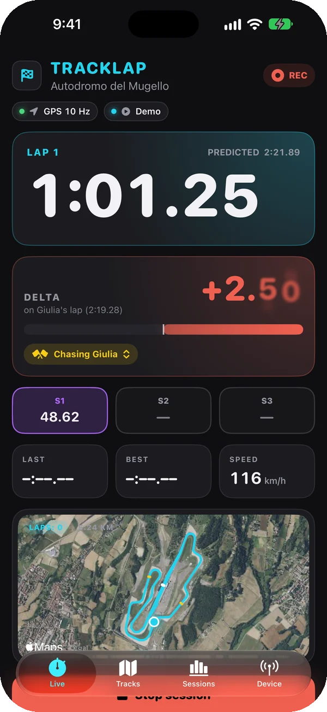</td>
    <td width="33%">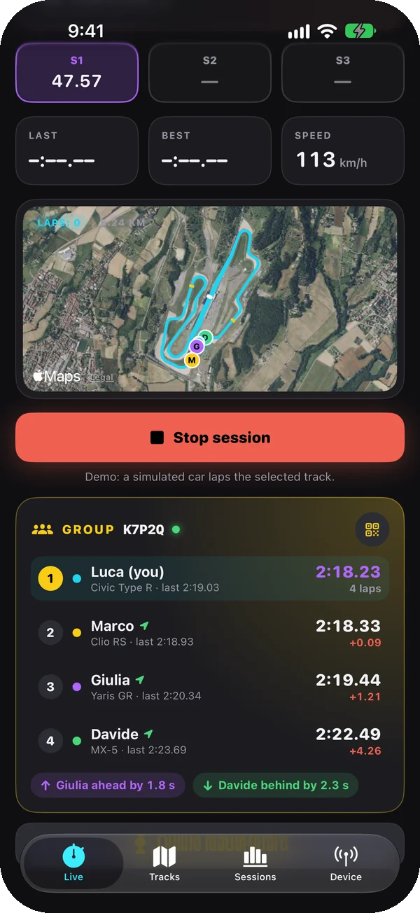</td>
    <td width="33%">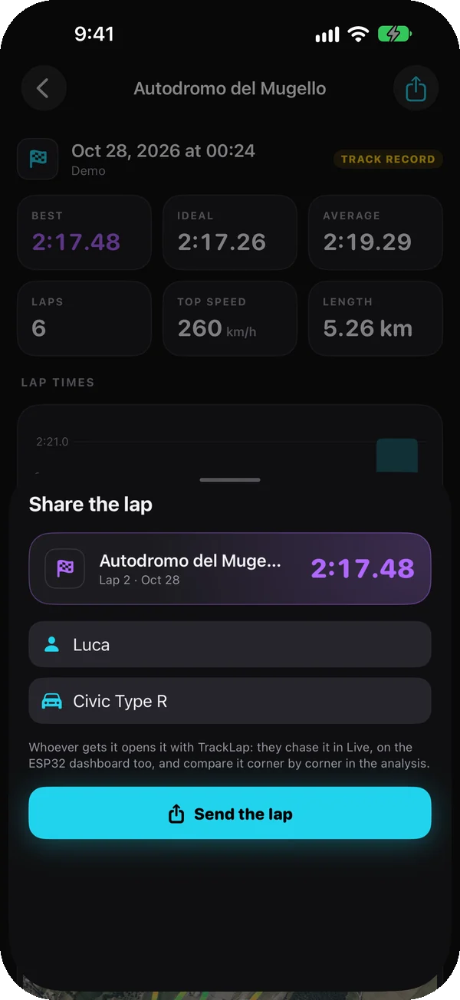</td>
  </tr>
  <tr>
    <td align="center">Chasing a friend's lap</td>
    <td align="center">The live group</td>
    <td align="center">A lap to send</td>
  </tr>
</table>

Groups and leaderboards go through the TrackLap server in [`server/`](server/README.md), a Cloudflare
Worker with Durable Objects: it gets your name, vehicle and times, and your position only while you
are in a group.

## Drag

The **Drag** tab turns TrackLap into a performance meter. Stopped, press **Ready to go**, *READY*
comes up, and the clock starts as soon as the car moves: one press, one run (in the Drag menu the
start can also be automatic, after a second standing still). Times come from the GPS speed
(steadier than the positions) and the distance from adding it up, each threshold interpolated
between two fixes: at 10 Hz or more they are good to a few hundredths.

- **Standing start**: 0–50, 0–100, 0–150 and 0–200 km/h; 60 ft, 1/8 and 1/4 mile and 1000 m, with
  the trap speed. With the *1 ft rollout* the clock starts after the first foot, as on a drag strip.
- **Rolling**: 80–120 and 100–200 km/h, on the move, without stopping.
- **Braking**: 100–0 km/h, with the stopping distance.
- In mph: 0–30, 0–60, 0–100 and 0–130, 50–70 and 60–130, the half mile instead of 1000 m, and 60–0.
- For every run the road's **slope** from the GPS altitude (downhill times can't be compared), the
  peak g, the speed and acceleration charts and a **picture to share**. Your best of each measure is
  in purple, and the voice reads 0–100, the quarter mile and braking.
- On the Waveshare the dashboard switches to drag: the speed in big digits, *READY* when stopped,
  *GO* with the run's time, and the main results for 5 seconds.

<table>
  <tr>
    <td width="33%">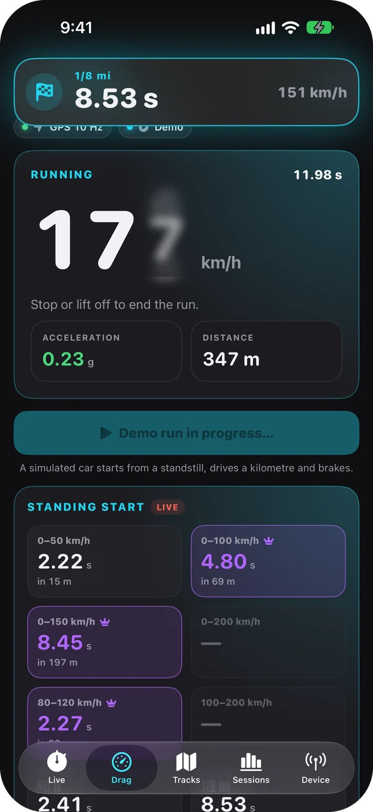</td>
    <td width="33%">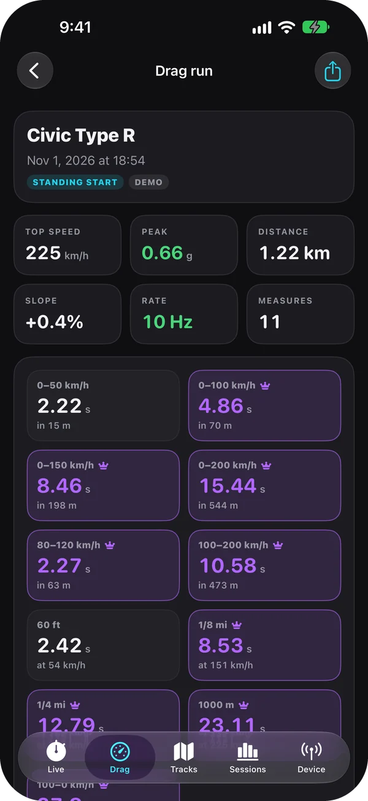</td>
  </tr>
  <tr>
    <td align="center">A run, live</td>
    <td align="center">Every measure of a run</td>
  </tr>
</table>

Only ever test where the road is closed to traffic.

## Garage and setups

The **Garage** holds the cars you drive on track: each with a photo, the year, the power, the
weight and every modification. The one you drive in Live sits on top, and every session, drag run
and leaderboard time remembers the car it was set with.

- **Public garage**: with a TrackLap account the garage gets a link that opens without the app too,
  and on the track leaderboards every time leads to the car it was set with.
- **Setups**: for every car as many setups as you like, one for the wet, one for the dry, one per
  track, with pressures, geometry, dampers, springs, anti-roll bars, wing and brakes. Changing one
  deletes nothing: the version before stays in the history, with what changed.
- Every session keeps the setup **as it was that day**, and when it rains at the track Live offers
  your setup for the wet.
- Setups **never go online**: they leave the phone only as a `.tracklapsetup` file you export.

<table>
  <tr>
    <td width="33%">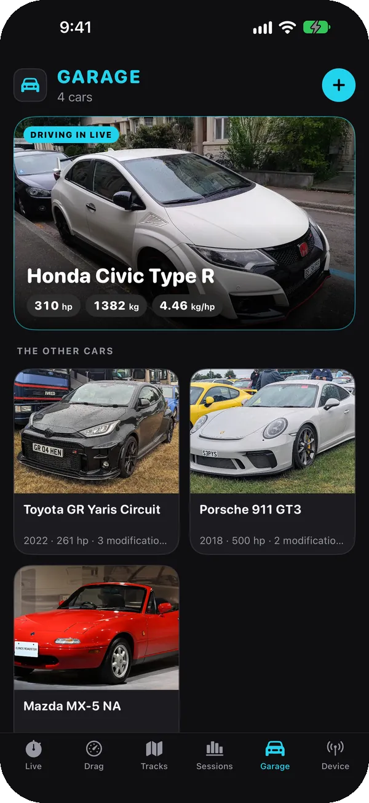</td>
    <td width="33%">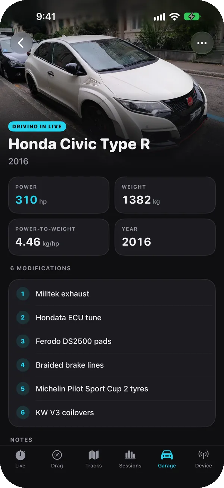</td>
    <td width="33%">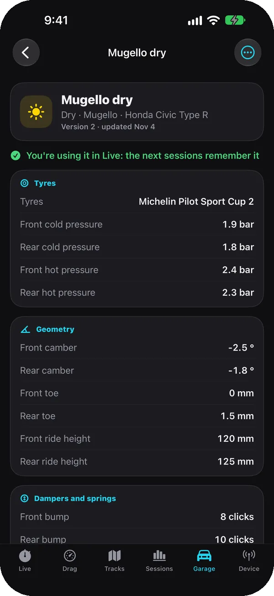</td>
  </tr>
  <tr>
    <td align="center">The garage</td>
    <td align="center">A car, its modifications and its setups</td>
    <td align="center">A setup, with its version history</td>
  </tr>
</table>

Car photos from Wikimedia Commons, CC0: [list](screenshots/garage/CREDITS.md).

## The hardware

  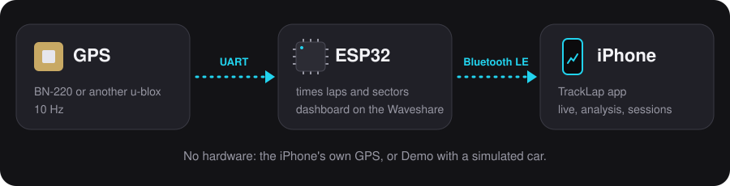

**Any ESP32 with Bluetooth** does (ESP32-WROOM-32, S3, C3, C5, C6, H2) plus a GPS, for example the
Beitian BN-220: the ESP32 sets the GPS to 10 Hz, times laps and sectors by itself and sends it all
to the app. Install the firmware from the browser at **[esp32.tbsgaming.win](https://esp32.tbsgaming.win)**;
the [wiring](#esp32-firmware) is below, with a diagram for every board.

On the **Waveshare ESP32-C6-LCD-1.47** the screen is a dashboard:

  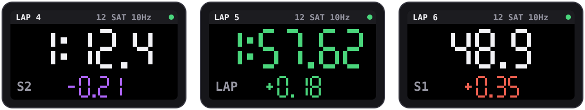

At each sector line the delta against the best lap: purple when you are the fastest ever there,
green when ahead of the previous lap, red when behind. At the finish the lap time: purple for a best
lap, green when faster than the session's average, red when slower.

## Install

- **iPhone**: add the source
  `https://raw.githubusercontent.com/TheBlackSide243/feather-repo/main/apps.json` to
  [Feather](https://github.com/khcrysalis/Feather) and install TrackLap, or download
  `TrackLap-<version>-unsigned.ipa` from the [releases](https://github.com/TheBlackSide243/TrackLap/releases)
  and install it with Sideloadly or AltStore. To try it without hardware, pick **Demo** in Device.
- **ESP32**: open [esp32.tbsgaming.win](https://esp32.tbsgaming.win) in Chrome, Edge or Brave on a
  computer, plug the board in over USB and press Install. Then in the app: Device → ESP32.

## Building

No Mac needed: on every push to `main` GitHub Actions (`.github/workflows/ipa.yml`) generates the
project with XcodeGen, builds it unsigned and publishes the `tracklap-ipa` artifact with
`TrackLap-<version>-unsigned.ipa`. Install it with Sideloadly, AltStore or Feather, which sign
it with your own Apple ID.

Each version is on the repo's Releases page and in the Feather source
`https://raw.githubusercontent.com/TheBlackSide243/feather-repo/main/apps.json`; what changed is in
[CHANGELOG.md](CHANGELOG.md), in English and Italian.

New version: bump `MARKETING_VERSION` (and `CURRENT_PROJECT_VERSION`) in `project.yml` and
`FW_VERSION` in `firmware/TrackLap/TrackLap.ino`: the app and the firmware always share the number.

Translations: the Italian text is the key in the code (`Text("…")`, `L("…")`); the table with the
other languages is in `tools/l10n.mjs`, which regenerates `Resources/<language>.lproj` with
`node tools/l10n.mjs`.

## ESP32 firmware

The firmware in `firmware/TrackLap` (Arduino, NimBLE) runs on every ESP32 with Bluetooth LE:
ESP32, ESP32-S3, ESP32-C3, ESP32-C5, ESP32-C6 and ESP32-H2. The ESP32-S2 and ESP32-P4 have no
Bluetooth and will not do.

- **GPS**: a u-blox (M7, M8 like the BN-220, M9, M10) is switched by itself to 115200 baud, 10 Hz
  and UBX NAV-PVT, with the automotive dynamic model; any other GPS is read as NMEA at whatever
  speed it talks. It can be plugged in after the board is on.
- **Laps**: with the track sent by the app the ESP32 times laps and sectors by itself (LAP packet),
  with the delta against the best lap at every line. The track and the best lap stay when it is
  switched off; the best lap is cleared when a different track arrives.
- **Display**: on the Waveshare ESP32-C6-LCD-1.47 (file `…-esp32c6-lcd147.bin`) the screen is a
  dashboard. During the lap it shows the time in big digits. At each sector line the delta against
  the best lap comes up for 4 seconds: purple when you are the fastest ever at that point, green when
  ahead of the previous lap, red when behind. At the finish the lap time comes up for 5 seconds with
  the gap: purple for a best lap, green when faster than the session's average, red when slower. Standing still it shows the speed;
  at the top the lap, satellites, rate and a green dot while the app is connected. With the app's
  Drag tab open it shows the speed, *READY* when stopped, *GO* with the run's time, and the main
  results.
- **LED**: on boards with an RGB LED it is red without GPS, yellow while waiting for a fix and green
  with a fix; it blinks until the app connects.

**Wiring**: power the GPS from 3.3 V or 5 V as its module says, common GND, then

| Board | GPS TX → GPIO | GPS RX ← GPIO |
|---|---|---|
| ESP32-WROOM-32 (DevKit: RX2, TX2) | 16 | 17 |
| ESP32-S3 | 18 | 17 |
| ESP32-C3, C5, C6, H2 | 4 | 5 |
| Waveshare ESP32-C6-LCD-1.47 | 17 (RX pin) | 16 (TX pin) |

In the diagrams the arrows show where the data goes: the GPS TX goes to the pin that receives,
its RX to the one that transmits. VCC goes to 3V3, or to 5V if the module asks for it.

  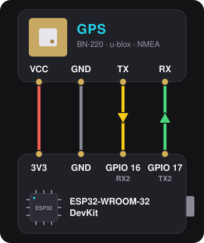
  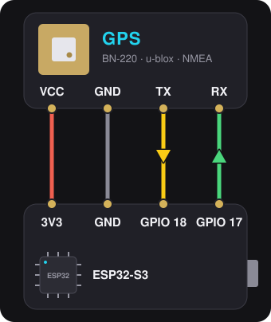

  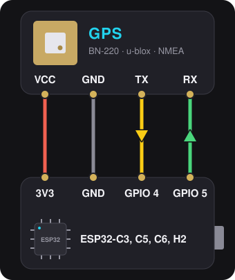
  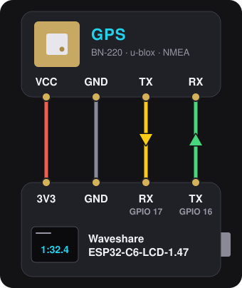

On the Waveshare GPIO 4 and 5 go to the microSD slot, so the GPS takes the header's RX and TX pins.
When the board uses those pins for something else (display, LED, the PSRAM of ESP32-WROVER modules
on 16 and 17), change them from the app (Device → ESP32 → Change pins) or from the USB serial
monitor at 115200 baud with `pins <rx> <tx>`; `pins default` goes back to the defaults, `info`
shows the state.

**Install**: open https://esp32.tbsgaming.win in Chrome, Edge or Brave on a computer, plug the
board in over USB and press Install: "Any ESP32 with Bluetooth" detects the chip by itself,
"Waveshare ESP32-C6-LCD-1.47" installs the build with the dashboard. Updates keep the pins and
the best lap. If the board does not connect, hold BOOT while plugging it in.

On every change in `firmware/` GitHub Actions (`.github/workflows/firmware.yml`) builds one file
per board listed in `firmware/build.txt`, `TrackLap-fw-<version>-<board>.bin`, in the
`tracklap-firmware` artifact: a merged image to write at `0x0` (for example with
https://espressif.github.io/esptool-js/), and the one the site publishes for each version.

## BLE protocol v1 (for the ESP32 firmware)

Service `7A1C0000-3F4B-4C8E-9D2A-6B1E5F0A9C10`, advertised name `TrackLap-XXXX`.
All numbers are little-endian.

| Characteristic | UUID | Properties | Content |
|---|---|---|---|
| FIX | `7A1C0001-…` | notify | one packet per GPS fix |
| LAP | `7A1C0002-…` | notify | lap timed by the ESP32 (optional) |
| TRACK | `7A1C0003-…` | write (with response) | start line and sectors |
| CONTROL | `7A1C0004-…` | write (with response) | commands |
| INFO | `7A1C0005-…` | read, notify | the ESP32's state as JSON |

**FIX**, 24 bytes; the first 20 fit the minimum MTU, and with that the app does without the altitude:

| Offset | Type | Field |
|---|---|---|
| 0 | u8 | version = 2 (1 up to firmware 0.6.0, 20 bytes without the altitude) |
| 1 | u8 | flags: bit0 valid fix, bit1 3D fix |
| 2 | u8 | satellites |
| 3 | u8 | GPS rate in Hz |
| 4 | u32 | iTOW in ms (GPS time of week, from NAV-PVT) |
| 8 | i32 | latitude × 1e7 |
| 12 | i32 | longitude × 1e7 |
| 16 | u16 | speed in cm/s |
| 18 | u16 | heading in hundredths of a degree |
| 20 | i32 | altitude above sea level in mm (`0x80000000` without a 3D fix) |

Without GPS the ESP32 sends an empty FIX (not valid, 0 satellites) every second.

**TRACK**: `u8 version = 1`, `u8 number of lines`, then for each line `i32 latA, i32 lonA,
i32 latB, i32 lonB` (× 1e7). The first line is the start, the others are the sectors.
The ESP32 stores it in flash and uses it to time laps by itself.

**LAP**, 14 bytes: `u8 version = 1`, `u8 type` (1 = lap, 2 = sector), `u16 lap number` (the one
that ended, or the one in progress for a sector), `u32 time in ms` (of the lap, or of the sector
alone), `u8 sector index` (from 0), `i32 delta in ms` against the best lap at the same line
(`0x7FFFFFFF` while there is none), `u8 flags`: bit0 new best lap, bits 1-2 the colour (0 none,
1 purple = the fastest ever, 2 green = better than the previous lap at a sector line or the average at
the finish, 3 red = worse).

**CONTROL**: `0x01` resets the ESP32 session; `0x02 rx tx` moves the GPS to other GPIOs, saves
them and restarts (`0x02 0xFF 0xFF` = the chip's default pins); `0x03 n` followed by `n` u32 values
in ms (a friend's lap time, then when it crossed sector lines 1 … n-1, 0 when unknown) sets the lap
to chase, and the deltas of LAP and of the dashboard are against it until `0x03` alone or another
track arrives; `0x04 position count i32 gap` is the place in the live group (position 0 = no group,
the gap in ms to the driver ahead, negative when first, `0x7FFFFFFF` for none), shown at the top of
the dashboard and, when it changes, for 4 seconds at the bottom; `0x05` is the drag dashboard of the
app's Drag tab: `0x05 0x00` goes back to the lap one, `0x05 0x01 state u32 ms` shows it (state 0
waiting for the car to stop, 1 ready, 2 a run that started that many ms ago), `0x05 0x02 flags u32
value label` shows a result for 5 seconds (flags bit0 a personal best, in purple, bit1 the value is a
distance in cm, else a time in ms; the label in ASCII, up to 12 characters).

**INFO**, for example
`{"fw":"0.7.0","chip":"ESP32-C6","board":"Waveshare ESP32-C6-LCD-1.47","gps":"u-blox M8","hz":10,"rx":17,"tx":16,"lines":3,"name":"TrackLap-1A2B"}`.
`gps` is empty while no GPS answers; a notification comes when the module, the rate or the track
changes.

## Next steps

1. The RaceChrono DIY service alongside, so the same device also works with RaceChrono; more
   boards with a display.

Maps and layouts © OpenStreetMap contributors.

## Licence

Proprietary software, all rights reserved: see [LICENSE](LICENSE).
