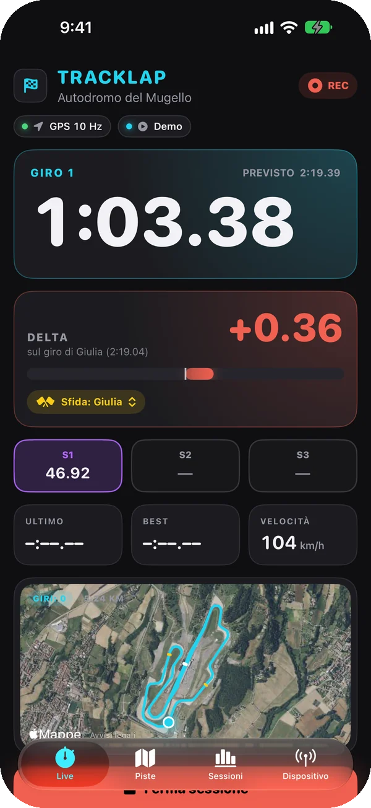
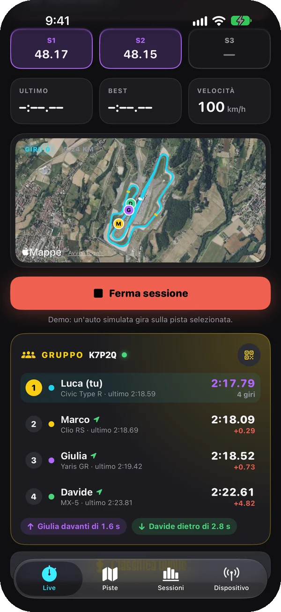
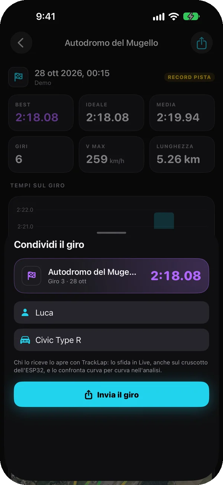
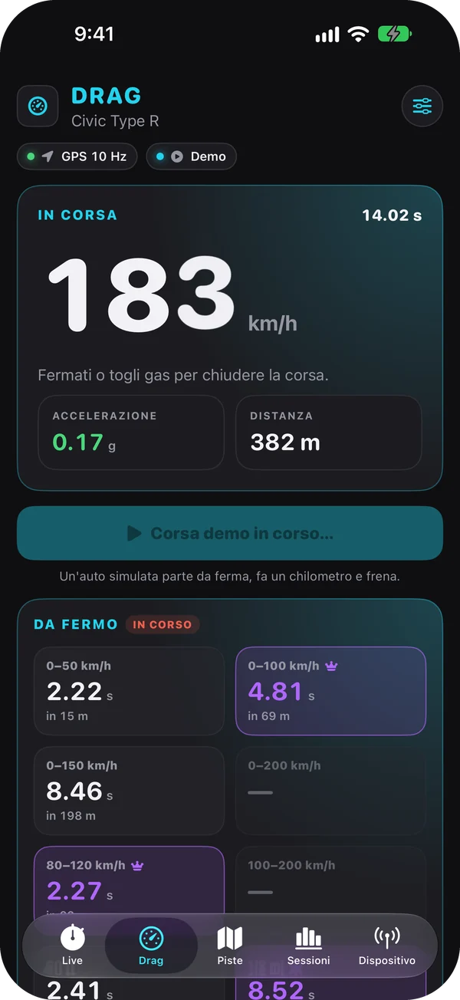
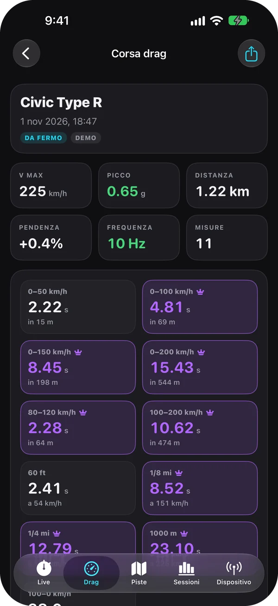
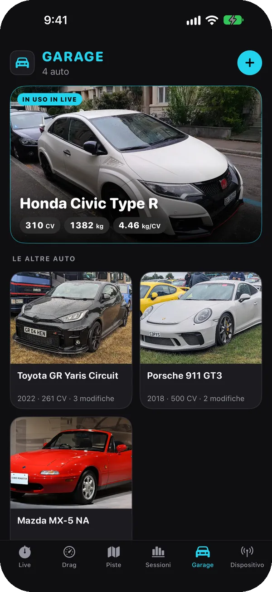
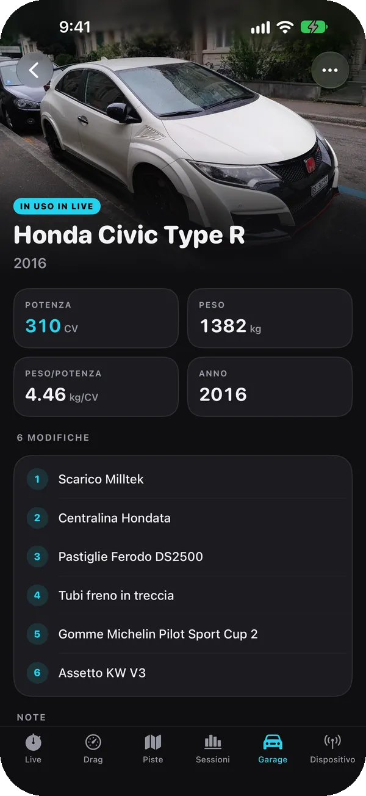
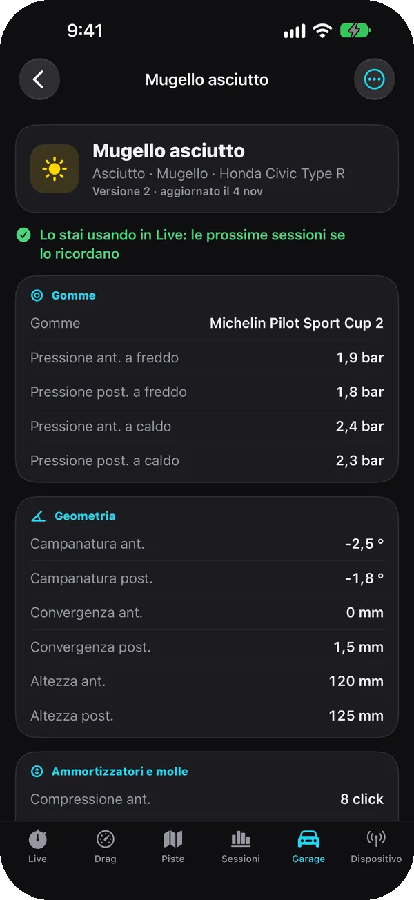
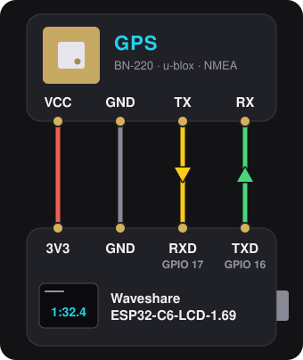

  

  <b>Italiano</b> · <a href="README.en.md">English</a>

  
  
  
  

**TrackLap** è un cronometro da pista per iPhone. Tempi sul giro, intermedi e delta in diretta
calcolati dal GPS: con un ESP32 e un GPS a 10 Hz collegati via Bluetooth, con il GPS dell'iPhone,
o con un'auto simulata per provare tutto subito. Il passaggio sulla linea viene interpolato tra due
fix, così a 10 Hz i tempi sono precisi a pochi centesimi.

<table>
  <tr>
    <td width="34%"></td>
    <td>
      <h3>Live</h3>
      
Il tempo del giro in corso, il <b>delta sul giro migliore</b> con la barra verde o rossa, il
      tempo previsto e i settori colorati: viola il migliore, verde meglio del giro prima, giallo più
      lento. Sotto l'ultimo giro, il best, la velocità e il circuito in vista satellite.

      
A fine giro vibrazione e <b>annuncio vocale</b> di tempo e distacco. Il delta può confrontare
      con il record della pista delle sessioni precedenti, così funziona già dal primo giro. Schermo
      sempre acceso, anche in orizzontale per il supporto sul cruscotto.

    </td>
  </tr>
  <tr>
    <td></td>
    <td>
      <h3>Piste</h3>
      
<b>Ricerca mentre scrivi</b> in tutto il mondo su OpenStreetMap, le piste vicino a te o a una
      città, un catalogo di <b>oltre 60 circuiti famosi</b> e "crea qui" sul posto.

      
Il tracciato si scarica da solo. Nell'editor sulla mappa satellitare tocchi la pista e la linea
      del via si mette di traverso da sola; aggiungi fino a 4 intermedi, oppure "segna qui" mette la
      linea dove sei.

    </td>
  </tr>
  <tr>
    <td></td>
    <td>
      <h3>Sessioni</h3>
      
Ogni giro viene salvato appena finisce. Per ogni sessione il best, il <b>giro ideale</b> (la
      somma dei settori migliori), la media, la velocità massima e il grafico dei tempi.

      
Esportazione in <b>GPX e CSV</b>, con velocità e g di ogni punto, per fogli di calcolo e
      programmi di analisi.

    </td>
  </tr>
  <tr>
    <td></td>
    <td>
      <h3>Analisi</h3>
      
Confronta un giro con un altro della sessione o con il best di una sessione precedente sulla
      stessa pista. Un solo cursore muove le due auto sulla mappa e sui grafici di velocità e delta.

      
Mappa colorata per velocità con la <b>velocità minima di ogni curva</b>, oppure per dove
      guadagni e perdi; confronto per settori e <b>cerchio delle accelerazioni</b> con i g laterali e
      longitudinali calcolati dal GPS.

    </td>
  </tr>
</table>

In italiano, inglese, spagnolo, francese, tedesco e portoghese, con la lingua dell'iPhone; km/h o mph.

## Con gli amici

- **Sfide**: da una sessione tocchi *Condividi il giro migliore* e mandi un file `.tracklap` con
  WhatsApp, Messaggi o AirDrop. Chi lo apre con TrackLap ritrova la pista con la stessa linea del
  via, sfida quel giro in Live (il delta è sul suo giro, anche sul cruscotto dell'ESP32, e a fine
  giro la voce dice il distacco) e lo confronta curva per curva nell'analisi. Niente account né
  server: funziona anche senza rete e in giorni diversi.
- **Gruppo live**: uno crea il gruppo e gli altri entrano con un codice di cinque caratteri o
  inquadrando il QR. In Live c'è la classifica del gruppo (best, ultimo giro, distacco dal primo),
  i puntini degli amici sulla mappa e il distacco vero dalle auto davanti e dietro, calcolato
  dall'orario GPS dei due passaggi nello stesso punto. A fine giro la voce dice la posizione e
  l'ESP32 la mostra sullo schermo. Ogni telefono cronometra da sé: la rete serve solo a mandare i
  tempi agli altri, quindi un ritardo o un buco di copertura non cambia i tempi.
- **Classifiche online**: chi attiva *Pubblica i miei best* manda il giro migliore di ogni sessione
  alla classifica della sua pista, riconosciuta dalla linea del via; ESP32 (10 Hz) e iPhone (1 Hz)
  hanno classifiche separate, i giri della Demo non entrano mai.

<table>
  <tr>
    <td width="33%"></td>
    <td width="33%"></td>
    <td width="33%"></td>
  </tr>
  <tr>
    <td align="center">La sfida al giro di un amico</td>
    <td align="center">Il gruppo live</td>
    <td align="center">Un giro da mandare</td>
  </tr>
</table>

Gruppi e classifiche passano dal server di TrackLap in [`server/`](server/README.md), un Cloudflare
Worker con Durable Objects: riceve nome, auto e tempi, e la posizione solo mentre sei in un gruppo.

## Drag

Nella scheda **Drag** TrackLap diventa un misuratore di prestazioni. Da fermo premi **Pronto al
via**, compare *PRONTO*, e il tempo parte appena l'auto si muove: una pressione, una corsa (dal menu
del Drag la partenza può anche essere automatica, dopo un secondo da fermo). I tempi vengono dalla
velocità del GPS (più stabile delle posizioni) e la distanza dalla sua somma, con ogni soglia
interpolata tra due fix: a 10 Hz o più sono precisi a pochi centesimi.

- **Da fermo**: 0–50, 0–100, 0–150 e 0–200 km/h; 60 ft, 1/8 e 1/4 di miglio e 1000 m, con la
  velocità all'arrivo. Con il *rollout di 1 ft* il tempo parte dopo il primo piede, come sulle piste
  di accelerazione.
- **Riprese**: 80–120 e 100–200 km/h, anche lanciati, senza fermarsi.
- **Frenata**: 100–0 km/h, con lo spazio di arresto.
- In mph: 0–30, 0–60, 0–100 e 0–130, 50–70 e 60–130, mezzo miglio al posto dei 1000 m e 60–0.
- Per ogni corsa la **pendenza** della strada dall'altitudine del GPS (in discesa i tempi non sono
  confrontabili), il picco di g, i grafici di velocità e accelerazione e un'**immagine da
  condividere**. I record personali di ogni misura sono in viola e la voce legge 0–100, quarto di
  miglio e frenata.
- Sulla Waveshare il cruscotto passa alla modalità drag: la velocità a cifre grandi, *READY* da
  fermo, *GO* con il tempo della corsa e i risultati principali per 5 secondi.

<table>
  <tr>
    <td width="33%"></td>
    <td width="33%"></td>
  </tr>
  <tr>
    <td align="center">Una corsa in diretta</td>
    <td align="center">Tutte le misure di una corsa</td>
  </tr>
</table>

Le prove si fanno solo dove la strada è chiusa al traffico.

## Garage e assetti

Nel **Garage** stanno le auto con cui giri: ognuna con una foto, l'anno, la potenza, il peso e tutte
le modifiche. Quella che usi in Live sta in cima, e ogni sessione, ogni corsa drag e ogni tempo in
classifica si ricorda con quale auto l'hai fatto.

- **Chi vede il garage**: con un account TrackLap scegli tu, solo io, gli amici o tutti. Mostrato a
  tutti, il garage ha un link che si apre anche senza l'app; nelle classifiche delle piste ogni tempo
  porta all'auto con cui è stato fatto.
- **Amici**: nella scheda Amici mandi un invito, e chi lo apre in TrackLap diventa tuo amico, e tu
  suo. Di ogni amico vedi il garage (anche quello mostrato solo agli amici), il giro migliore su
  ogni pista con il posto in classifica, e le statistiche: piste, sessioni, primi posti, pista
  preferita e ultima volta in pista.
- **Assetti**: per ogni auto tutti gli assetti che vuoi, uno per il bagnato, uno per l'asciutto,
  uno per pista, con pressioni, geometria, ammortizzatori, molle, barre, ala e frenata. Modificarne
  uno non cancella niente: la versione di prima resta nello storico, con cosa è cambiato.
- Ogni sessione tiene l'assetto **com'era quel giorno**, e se alla pista piove Live propone
  l'assetto da bagnato.
- Gli assetti **non vanno mai online**: si passano solo esportandoli in un file `.tracklapsetup`.

<table>
  <tr>
    <td width="33%"></td>
    <td width="33%"></td>
    <td width="33%"></td>
  </tr>
  <tr>
    <td align="center">Il garage</td>
    <td align="center">Un'auto, le sue modifiche e i suoi assetti</td>
    <td align="center">Un assetto, con lo storico delle versioni</td>
  </tr>
</table>

Foto delle auto da Wikimedia Commons, CC0: [elenco](screenshots/garage/CREDITS.md).

## L'hardware

  

Basta **qualsiasi ESP32 con Bluetooth** (ESP32-WROOM-32, S3, C3, C5, C6, H2) e un GPS, per esempio
il Beitian BN-220: l'ESP32 imposta il GPS a 10 Hz, cronometra giri e intermedi da solo e manda tutto
all'app. Il firmware si installa dal browser su **[esp32.tbsgaming.win](https://esp32.tbsgaming.win)**;
i [collegamenti](#firmware-esp32) sono qui sotto, con uno schema per ogni scheda.

Sulla **Waveshare ESP32-C6-LCD-1.47** lo schermo fa da cruscotto:

  

A ogni intermedio il delta sul giro migliore, viola se lì sei il più veloce di sempre, verde se sei
davanti al giro precedente, rosso se sei dietro. Al traguardo il tempo del giro: viola se è il
migliore, verde se è più veloce della media della sessione, rosso se è più lento.

## Installare

- **iPhone**: aggiungi a [Feather](https://github.com/khcrysalis/Feather) la sorgente
  `https://raw.githubusercontent.com/TheBlackSide243/feather-repo/main/apps.json` e installa
  TrackLap, oppure scarica `TrackLap-<versione>-unsigned.ipa` dalle
  [release](https://github.com/TheBlackSide243/TrackLap/releases) e installalo con Sideloadly o
  AltStore. Per provarlo senza hardware scegli **Demo** in Dispositivo.
- **ESP32**: apri [esp32.tbsgaming.win](https://esp32.tbsgaming.win) da Chrome, Edge o Brave sul
  computer, collega la scheda via USB e premi Installa. Poi nell'app: Dispositivo → ESP32.

## Compilare

Non serve un Mac: a ogni push su `main` GitHub Actions (`.github/workflows/ipa.yml`) genera il
progetto con XcodeGen, compila senza firma e pubblica l'artefatto `tracklap-ipa` con
`TrackLap-<versione>-unsigned.ipa`. Si installa con Sideloadly, AltStore o Feather, che lo
firmano con il proprio Apple ID.

Ogni versione è nelle release del repo e nella sorgente Feather
`https://raw.githubusercontent.com/TheBlackSide243/feather-repo/main/apps.json`; le novità sono in
[CHANGELOG.md](CHANGELOG.md), in inglese e in italiano.

Nuova versione: aumentare `MARKETING_VERSION` (e `CURRENT_PROJECT_VERSION`) in `project.yml` e
`FW_VERSION` in `firmware/TrackLap/TrackLap.ino`: app e firmware hanno sempre lo stesso numero.

Traduzioni: il testo italiano è la chiave nel codice (`Text("…")`, `L("…")`); la tabella con le altre
lingue è in `tools/l10n.mjs`, che rigenera `Resources/<lingua>.lproj` con `node tools/l10n.mjs`.

## Firmware ESP32

Il firmware in `firmware/TrackLap` (Arduino, NimBLE) gira su tutti gli ESP32 con Bluetooth LE:
ESP32, ESP32-S3, ESP32-C3, ESP32-C5, ESP32-C6 ed ESP32-H2. L'ESP32-S2 e l'ESP32-P4 non hanno il
Bluetooth e non vanno bene.

- **GPS**: un u-blox (M7, M8 come il BN-220, M9, M10) viene portato da solo a 115200 baud, 10 Hz e
  UBX NAV-PVT, con il modello dinamico per auto; qualsiasi altro GPS viene letto in NMEA alla velocità
  a cui parla. Si può collegare anche a scheda già accesa.
- **Giri**: con la pista inviata dall'app l'ESP32 cronometra giri e intermedi da solo (pacchetto LAP),
  con il delta sul giro migliore a ogni linea. Pista e giro migliore restano anche da spento; il giro
  migliore si azzera quando arriva una pista diversa.
- **Display**: sulla Waveshare ESP32-C6-LCD-1.47 (file `…-esp32c6-lcd147.bin`) lo schermo fa da
  cruscotto. Durante il giro c'è il tempo a cifre grandi. A ogni intermedio compare per 4 secondi il
  delta sul giro migliore: viola se a quel punto sei il più veloce di sempre, verde se sei davanti al
  giro precedente, rosso se sei dietro. Al traguardo compare per 5 secondi il tempo del giro con il
  distacco: viola se è il giro migliore, verde se è più veloce della media della sessione, rosso se è
  più lento. Fermo mostra la velocità; in
  alto giro, satelliti, frequenza e il pallino verde quando l'app è collegata. Con la scheda Drag
  dell'app aperta mostra la velocità, *READY* da fermo, *GO* con il tempo della corsa e i risultati
  principali.
- **Versione Touch**: la Waveshare ESP32-C6-Touch-LCD-1.47 (file `…-esp32c6-touch-lcd147.bin`) è
  un'altra scheda, con schermo JD9853 e accelerometro QMI8658: ha lo stesso cruscotto e manda i g
  che misura, che l'app usa per il cerchio delle accelerazioni invece di ricavarli dal GPS. Impara
  da sola come è montata: il basso da fermo, l'avanti dalle prime accelerazioni e frenate in
  rettilineo; se lo ricorda, e lo reimpara se la sposti. Fissala bene, non su qualcosa che balla.
- **Schermo da 1,69"**: la Waveshare ESP32-C6-LCD-1.69 (file `…-esp32c6-lcd169.bin`) ha uno schermo
  240 × 280 con gli angoli arrotondati, usato in orizzontale, e l'accelerometro QMI8658: lo stesso
  cruscotto, disposto per il suo schermo, e i g misurati come la Touch. A batteria si accende con il
  suo tasto PWR.
- **LED**: sulle schede con il LED RGB è rosso senza GPS, giallo in attesa del fix e verde con il fix;
  lampeggia finché l'app non si collega.

**Collegamento**: GPS alimentato a 3,3 V o 5 V come indicato sul modulo, GND in comune, poi

| Scheda | TX del GPS → GPIO | RX del GPS ← GPIO |
|---|---|---|
| ESP32-WROOM-32 (DevKit: RX2, TX2) | 16 | 17 |
| ESP32-S3 | 18 | 17 |
| ESP32-C3, C5, C6, H2 | 4 | 5 |
| Waveshare ESP32-C6-LCD-1.47 | 17 (pin RX) | 16 (pin TX) |
| Waveshare ESP32-C6-Touch-LCD-1.47 | 17 (pin RX) | 16 (pin TX) |
| Waveshare ESP32-C6-LCD-1.69 | 17 (pin RXD) | 16 (pin TXD) |

Negli schemi le frecce indicano dove vanno i dati: il TX del GPS va al pin che riceve, l'RX a
quello che trasmette. Il VCC va al 3V3, o al 5V se il modulo lo chiede.

  
  

  
  

  
  

Sulle Waveshare il GPS usa i pin RX e TX del connettore (su quella senza touch i GPIO 4
e 5 vanno allo slot microSD). Se la scheda usa quei pin per altro (display, LED, la PSRAM dei moduli ESP32-WROVER su
16 e 17), si cambiano dall'app (Dispositivo → ESP32 → Cambia pin) oppure dal monitor seriale USB a
115200 baud con `pins <rx> <tx>`; `pins default` torna ai predefiniti, `info` mostra lo stato.

**Installazione**: apri https://esp32.tbsgaming.win da Chrome, Edge o Brave sul computer, collega
la scheda via USB e premi Installa: "Qualsiasi ESP32 con Bluetooth" riconosce il chip da solo,
"Waveshare ESP32-C6-LCD-1.47 (senza touch)", "Waveshare ESP32-C6-Touch-LCD-1.47 (touch)" e
"Waveshare ESP32-C6-LCD-1.69" mettono la versione con il cruscotto di ciascuna: non sono la stessa
scheda. Gli aggiornamenti tengono pin
e giro migliore. Se la scheda non si collega, tieni premuto BOOT mentre la colleghi.

A ogni modifica in `firmware/` GitHub Actions (`.github/workflows/firmware.yml`) compila un file
per ogni scheda elencata in `firmware/build.txt`, `TrackLap-fw-<versione>-<scheda>.bin`, nell'artefatto
`tracklap-firmware`: è un'immagine unita da scrivere a `0x0` (per esempio con
https://espressif.github.io/esptool-js/), ed è quella che il sito pubblica a ogni versione.

## Protocollo BLE v1 (per il firmware ESP32)

Servizio `7A1C0000-3F4B-4C8E-9D2A-6B1E5F0A9C10`, nome pubblicizzato `TrackLap-XXXX`.
Tutti i numeri sono little-endian.

| Caratteristica | UUID | Proprietà | Contenuto |
|---|---|---|---|
| FIX | `7A1C0001-…` | notify | un pacchetto per ogni fix GPS |
| LAP | `7A1C0002-…` | notify | giro cronometrato dall'ESP32 (facoltativo) |
| TRACK | `7A1C0003-…` | write (con risposta) | linea del via e intermedi |
| CONTROL | `7A1C0004-…` | write (con risposta) | comandi |
| INFO | `7A1C0005-…` | read, notify | stato dell'ESP32 in JSON |

**FIX**, 28 byte; i primi 20 entrano nell'MTU minimo, e con quello l'app fa a meno dell'altitudine
e dei g:

| Offset | Tipo | Campo |
|---|---|---|
| 0 | u8 | versione = 2 (1 fino al firmware 0.6.0, 20 byte senza altitudine) |
| 1 | u8 | flag: bit0 fix valido, bit1 fix 3D |
| 2 | u8 | satelliti |
| 3 | u8 | frequenza GPS in Hz |
| 4 | u32 | iTOW in ms (tempo GPS della settimana, da NAV-PVT) |
| 8 | i32 | latitudine × 1e7 |
| 12 | i32 | longitudine × 1e7 |
| 16 | u16 | velocità in cm/s |
| 18 | u16 | direzione in centesimi di grado |
| 20 | i32 | altitudine sul livello del mare in mm (`0x80000000` senza fix 3D) |
| 24 | i16 | g laterali dall'accelerometro della scheda in milli-g, + girando a destra (`0x8000` senza, o mentre impara come è montata; dalla 0.9.2) |
| 26 | i16 | g longitudinali in milli-g, + accelerando (`0x8000` per nessuno) |

Senza GPS l'ESP32 manda un FIX vuoto (non valido, 0 satelliti) ogni secondo.

**TRACK**: `u8 versione = 1`, `u8 numero di linee`, poi per ogni linea `i32 latA, i32 lonA,
i32 latB, i32 lonB` (× 1e7). La prima linea è il via, le altre sono gli intermedi.
L'ESP32 la salva in flash e la usa per cronometrare da solo.

**LAP**, 14 byte: `u8 versione = 1`, `u8 tipo` (1 = giro, 2 = intermedio), `u16 numero del giro`
(quello finito, o quello in corso per un intermedio), `u32 tempo in ms` (del giro, o del solo
intermedio), `u8 indice dell'intermedio` (da 0), `i32 delta in ms` sul giro migliore alla stessa
linea (`0x7FFFFFFF` se non c'è ancora), `u8 flag`: bit0 nuovo giro migliore, bit 1-2 il colore
(0 nessuno, 1 viola = il più veloce di sempre, 2 verde = meglio del giro precedente all'intermedio o
della media al traguardo, 3 rosso = peggio).

**CONTROL**: `0x01` azzera la sessione dell'ESP32; `0x02 rx tx` sposta il GPS su altri GPIO, li
salva e riavvia (`0x02 0xFF 0xFF` = pin predefiniti del chip); `0x03 n` seguito da `n` valori u32 in
ms (il tempo del giro di un amico, poi quando ha passato gli intermedi 1 … n-1, 0 se non si sa)
imposta il giro da sfidare, e i delta di LAP e del cruscotto diventano su quel giro finché arriva
`0x03` da solo o un'altra pista; `0x04 posizione numero i32 distacco` è il posto nel gruppo live
(posizione 0 = nessun gruppo, distacco in ms da chi sta davanti, negativo per il primo, `0x7FFFFFFF`
se non c'è), che il cruscotto mostra in alto e, quando cambia, per 4 secondi in basso; `0x05` è il
cruscotto drag della scheda Drag dell'app: `0x05 0x00` torna a quello dei giri, `0x05 0x01 stato
u32 ms` lo mostra (stato 0 in attesa che l'auto si fermi, 1 pronto, 2 corsa partita da quei ms),
`0x05 0x02 flag u32 valore etichetta` mostra un risultato per 5 secondi (flag bit0 record personale,
in viola, bit1 il valore è una distanza in cm, altrimenti un tempo in ms; l'etichetta in ASCII, fino
a 12 caratteri).

**INFO**, per esempio
`{"fw":"0.7.0","chip":"ESP32-C6","board":"Waveshare ESP32-C6-LCD-1.47","gps":"u-blox M8","hz":10,"rx":17,"tx":16,"lines":3,"name":"TrackLap-1A2B"}`.
`gps` è vuoto finché nessun GPS risponde; arriva una notifica quando cambiano il modulo, la
frequenza o la pista.

## Prossimi passi

1. Servizio RaceChrono DIY in parallelo, così lo stesso dispositivo funziona anche con RaceChrono;
   altre schede con display.

Mappe e tracciati © OpenStreetMap contributors.

## Licenza

Software proprietario, tutti i diritti riservati: vedi [LICENSE](LICENSE).
