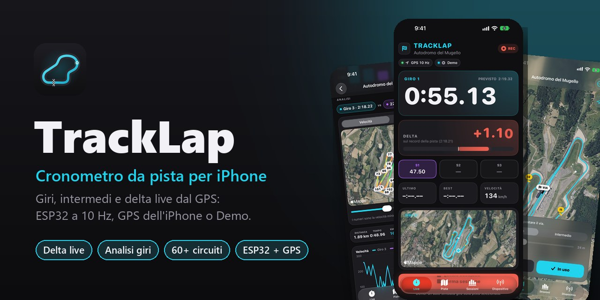
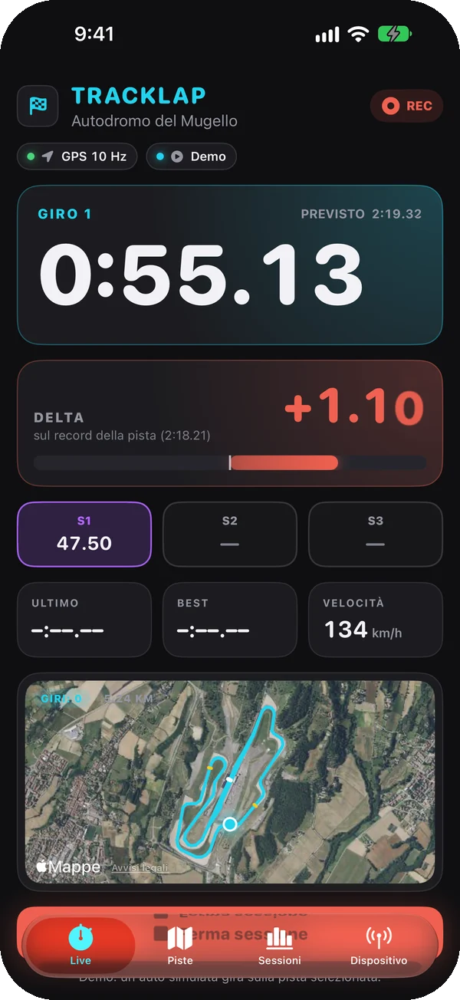
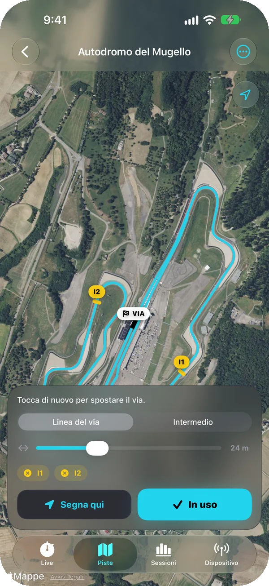
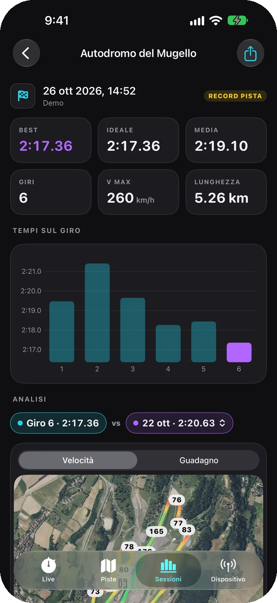
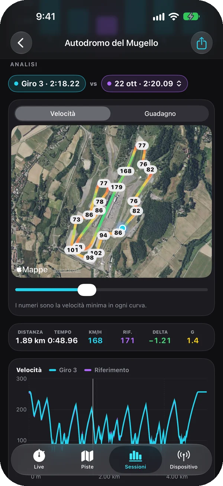
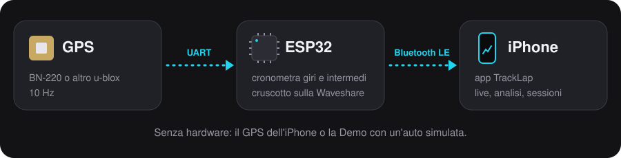
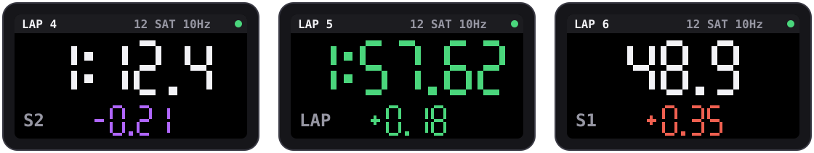
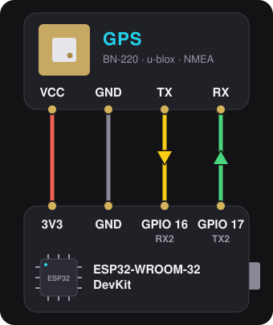
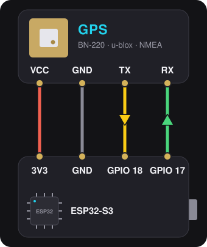
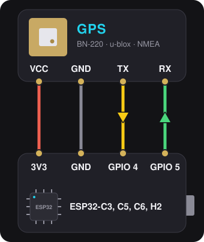

  

  <b>Italiano</b> · <a href="README.en.md">English</a>

  
  
  
  

**TrackLap** è un cronometro da pista per iPhone. Tempi sul giro, intermedi e delta in diretta
calcolati dal GPS: con un ESP32 e un GPS a 10 Hz collegati via Bluetooth, con il GPS dell'iPhone,
o con un'auto simulata per provare tutto subito. Il passaggio sulla linea viene interpolato tra due
fix, così a 10 Hz i tempi sono precisi a pochi centesimi.

<table>
  <tr>
    <td width="34%"></td>
    <td>
      <h3>Live</h3>
      
Il tempo del giro in corso, il <b>delta sul giro migliore</b> con la barra verde o rossa, il
      tempo previsto e i settori colorati: viola il migliore, verde meglio del giro prima, giallo più
      lento. Sotto l'ultimo giro, il best, la velocità e il circuito in vista satellite.

      
A fine giro vibrazione e <b>annuncio vocale</b> di tempo e distacco. Il delta può confrontare
      con il record della pista delle sessioni precedenti, così funziona già dal primo giro. Schermo
      sempre acceso, anche in orizzontale per il supporto sul cruscotto.

    </td>
  </tr>
  <tr>
    <td></td>
    <td>
      <h3>Piste</h3>
      
<b>Ricerca mentre scrivi</b> in tutto il mondo su OpenStreetMap, le piste vicino a te o a una
      città, un catalogo di <b>oltre 60 circuiti famosi</b> e "crea qui" sul posto.

      
Il tracciato si scarica da solo. Nell'editor sulla mappa satellitare tocchi la pista e la linea
      del via si mette di traverso da sola; aggiungi fino a 4 intermedi, oppure "segna qui" mette la
      linea dove sei.

    </td>
  </tr>
  <tr>
    <td></td>
    <td>
      <h3>Sessioni</h3>
      
Ogni giro viene salvato appena finisce. Per ogni sessione il best, il <b>giro ideale</b> (la
      somma dei settori migliori), la media, la velocità massima e il grafico dei tempi.

      
Esportazione in <b>GPX e CSV</b>, con velocità e g di ogni punto, per fogli di calcolo e
      programmi di analisi.

    </td>
  </tr>
  <tr>
    <td></td>
    <td>
      <h3>Analisi</h3>
      
Confronta un giro con un altro della sessione o con il best di una sessione precedente sulla
      stessa pista. Un solo cursore muove le due auto sulla mappa e sui grafici di velocità e delta.

      
Mappa colorata per velocità con la <b>velocità minima di ogni curva</b>, oppure per dove
      guadagni e perdi; confronto per settori e <b>cerchio delle accelerazioni</b> con i g laterali e
      longitudinali calcolati dal GPS.

    </td>
  </tr>
</table>

In italiano, inglese, spagnolo, francese, tedesco e portoghese, con la lingua dell'iPhone; km/h o mph.

## L'hardware

  

Basta **qualsiasi ESP32 con Bluetooth** (ESP32-WROOM-32, S3, C3, C5, C6, H2) e un GPS, per esempio
il Beitian BN-220: l'ESP32 imposta il GPS a 10 Hz, cronometra giri e intermedi da solo e manda tutto
all'app. Il firmware si installa dal browser su **[esp32.tbsgaming.win](https://esp32.tbsgaming.win)**;
i [collegamenti](#firmware-esp32) sono qui sotto, con uno schema per ogni scheda.

Sulla **Waveshare ESP32-C6-LCD-1.47** lo schermo fa da cruscotto:

  

A ogni intermedio il delta sul giro migliore, viola se lì sei il più veloce di sempre, verde se sei
davanti al giro precedente, rosso se sei dietro. Al traguardo il tempo del giro: viola se è il
migliore, verde se è più veloce della media della sessione, rosso se è più lento.

## Installare

- **iPhone**: aggiungi a [Feather](https://github.com/khcrysalis/Feather) la sorgente
  `https://raw.githubusercontent.com/TheBlackSide243/feather-repo/main/apps.json` e installa
  TrackLap, oppure scarica `TrackLap-<versione>-unsigned.ipa` dalle
  [release](https://github.com/TheBlackSide243/TrackLap/releases) e installalo con Sideloadly o
  AltStore. Per provarlo senza hardware scegli **Demo** in Dispositivo.
- **ESP32**: apri [esp32.tbsgaming.win](https://esp32.tbsgaming.win) da Chrome, Edge o Brave sul
  computer, collega la scheda via USB e premi Installa. Poi nell'app: Dispositivo → ESP32.

## Compilare

Non serve un Mac: a ogni push su `main` GitHub Actions (`.github/workflows/ipa.yml`) genera il
progetto con XcodeGen, compila senza firma e pubblica l'artefatto `tracklap-ipa` con
`TrackLap-<versione>-unsigned.ipa`. Si installa con Sideloadly, AltStore o Feather, che lo
firmano con il proprio Apple ID.

Ogni versione è nelle release del repo e nella sorgente Feather
`https://raw.githubusercontent.com/TheBlackSide243/feather-repo/main/apps.json`; le novità sono in
[CHANGELOG.md](CHANGELOG.md), in inglese e in italiano.

Nuova versione: aumentare `MARKETING_VERSION` (e `CURRENT_PROJECT_VERSION`) in `project.yml`.

Traduzioni: il testo italiano è la chiave nel codice (`Text("…")`, `L("…")`); la tabella con le altre
lingue è in `tools/l10n.mjs`, che rigenera `Resources/<lingua>.lproj` con `node tools/l10n.mjs`.

## Firmware ESP32

Il firmware in `firmware/TrackLap` (Arduino, NimBLE) gira su tutti gli ESP32 con Bluetooth LE:
ESP32, ESP32-S3, ESP32-C3, ESP32-C5, ESP32-C6 ed ESP32-H2. L'ESP32-S2 e l'ESP32-P4 non hanno il
Bluetooth e non vanno bene.

- **GPS**: un u-blox (M7, M8 come il BN-220, M9, M10) viene portato da solo a 115200 baud, 10 Hz e
  UBX NAV-PVT, con il modello dinamico per auto; qualsiasi altro GPS viene letto in NMEA alla velocità
  a cui parla. Si può collegare anche a scheda già accesa.
- **Giri**: con la pista inviata dall'app l'ESP32 cronometra giri e intermedi da solo (pacchetto LAP),
  con il delta sul giro migliore a ogni linea. Pista e giro migliore restano anche da spento; il giro
  migliore si azzera quando arriva una pista diversa.
- **Display**: sulla Waveshare ESP32-C6-LCD-1.47 (file `…-esp32c6-lcd147.bin`) lo schermo fa da
  cruscotto. Durante il giro c'è il tempo a cifre grandi. A ogni intermedio compare per 4 secondi il
  delta sul giro migliore: viola se a quel punto sei il più veloce di sempre, verde se sei davanti al
  giro precedente, rosso se sei dietro. Al traguardo compare per 5 secondi il tempo del giro con il
  distacco: viola se è il giro migliore, verde se è più veloce della media della sessione, rosso se è
  più lento. Fermo mostra la velocità; in
  alto giro, satelliti, frequenza e il pallino verde quando l'app è collegata.
- **LED**: sulle schede con il LED RGB è rosso senza GPS, giallo in attesa del fix e verde con il fix;
  lampeggia finché l'app non si collega.

**Collegamento**: GPS alimentato a 3,3 V o 5 V come indicato sul modulo, GND in comune, poi

| Scheda | TX del GPS → GPIO | RX del GPS ← GPIO |
|---|---|---|
| ESP32-WROOM-32 (DevKit: RX2, TX2) | 16 | 17 |
| ESP32-S3 | 18 | 17 |
| ESP32-C3, C5, C6, H2 | 4 | 5 |
| Waveshare ESP32-C6-LCD-1.47 | 17 (pin RX) | 16 (pin TX) |

Negli schemi le frecce indicano dove vanno i dati: il TX del GPS va al pin che riceve, l'RX a
quello che trasmette. Il VCC va al 3V3, o al 5V se il modulo lo chiede.

  
  

  
  

Sulla Waveshare i GPIO 4 e 5 vanno allo slot microSD, per questo il GPS usa i pin RX e TX del
connettore. Se la scheda usa quei pin per altro (display, LED, la PSRAM dei moduli ESP32-WROVER su
16 e 17), si cambiano dall'app (Dispositivo → ESP32 → Cambia pin) oppure dal monitor seriale USB a
115200 baud con `pins <rx> <tx>`; `pins default` torna ai predefiniti, `info` mostra lo stato.

**Installazione**: apri https://esp32.tbsgaming.win da Chrome, Edge o Brave sul computer, collega
la scheda via USB e premi Installa: "Qualsiasi ESP32 con Bluetooth" riconosce il chip da solo,
"Waveshare ESP32-C6-LCD-1.47" mette la versione con il cruscotto. Gli aggiornamenti tengono pin
e giro migliore. Se la scheda non si collega, tieni premuto BOOT mentre la colleghi.

A ogni modifica in `firmware/` GitHub Actions (`.github/workflows/firmware.yml`) compila un file
per ogni scheda elencata in `firmware/build.txt`, `TrackLap-fw-<versione>-<scheda>.bin`, nell'artefatto
`tracklap-firmware`: è un'immagine unita da scrivere a `0x0` (per esempio con
https://espressif.github.io/esptool-js/), ed è quella che il sito pubblica a ogni versione.

## Protocollo BLE v1 (per il firmware ESP32)

Servizio `7A1C0000-3F4B-4C8E-9D2A-6B1E5F0A9C10`, nome pubblicizzato `TrackLap-XXXX`.
Tutti i numeri sono little-endian.

| Caratteristica | UUID | Proprietà | Contenuto |
|---|---|---|---|
| FIX | `7A1C0001-…` | notify | un pacchetto per ogni fix GPS |
| LAP | `7A1C0002-…` | notify | giro cronometrato dall'ESP32 (facoltativo) |
| TRACK | `7A1C0003-…` | write (con risposta) | linea del via e intermedi |
| CONTROL | `7A1C0004-…` | write (con risposta) | comandi |
| INFO | `7A1C0005-…` | read, notify | stato dell'ESP32 in JSON |

**FIX**, 20 byte (entra nell'MTU minimo):

| Offset | Tipo | Campo |
|---|---|---|
| 0 | u8 | versione = 1 |
| 1 | u8 | flag: bit0 fix valido, bit1 fix 3D |
| 2 | u8 | satelliti |
| 3 | u8 | frequenza GPS in Hz |
| 4 | u32 | iTOW in ms (tempo GPS della settimana, da NAV-PVT) |
| 8 | i32 | latitudine × 1e7 |
| 12 | i32 | longitudine × 1e7 |
| 16 | u16 | velocità in cm/s |
| 18 | u16 | direzione in centesimi di grado |

Senza GPS l'ESP32 manda un FIX vuoto (non valido, 0 satelliti) ogni secondo.

**TRACK**: `u8 versione = 1`, `u8 numero di linee`, poi per ogni linea `i32 latA, i32 lonA,
i32 latB, i32 lonB` (× 1e7). La prima linea è il via, le altre sono gli intermedi.
L'ESP32 la salva in flash e la usa per cronometrare da solo.

**LAP**, 14 byte: `u8 versione = 1`, `u8 tipo` (1 = giro, 2 = intermedio), `u16 numero del giro`
(quello finito, o quello in corso per un intermedio), `u32 tempo in ms` (del giro, o del solo
intermedio), `u8 indice dell'intermedio` (da 0), `i32 delta in ms` sul giro migliore alla stessa
linea (`0x7FFFFFFF` se non c'è ancora), `u8 flag`: bit0 nuovo giro migliore, bit 1-2 il colore
(0 nessuno, 1 viola = il più veloce di sempre, 2 verde = meglio del giro precedente all'intermedio o
della media al traguardo, 3 rosso = peggio).

**CONTROL**: `0x01` azzera la sessione dell'ESP32; `0x02 rx tx` sposta il GPS su altri GPIO, li
salva e riavvia (`0x02 0xFF 0xFF` = pin predefiniti del chip).

**INFO**, per esempio
`{"fw":"0.1.0","chip":"ESP32-C6","board":"Waveshare ESP32-C6-LCD-1.47","gps":"u-blox M8","hz":10,"rx":17,"tx":16,"lines":3,"name":"TrackLap-1A2B"}`.
`gps` è vuoto finché nessun GPS risponde; arriva una notifica quando cambiano il modulo, la
frequenza o la pista.

## Prossimi passi

1. Servizio RaceChrono DIY in parallelo, così lo stesso dispositivo funziona anche con RaceChrono;
   altre schede con display.
2. Multiplayer: server sull'homelab (WebSocket/MQTT), sessioni condivise con codice o QR,
   classifica e mappa live, delta sul best di un amico.

Mappe e tracciati © OpenStreetMap contributors.
